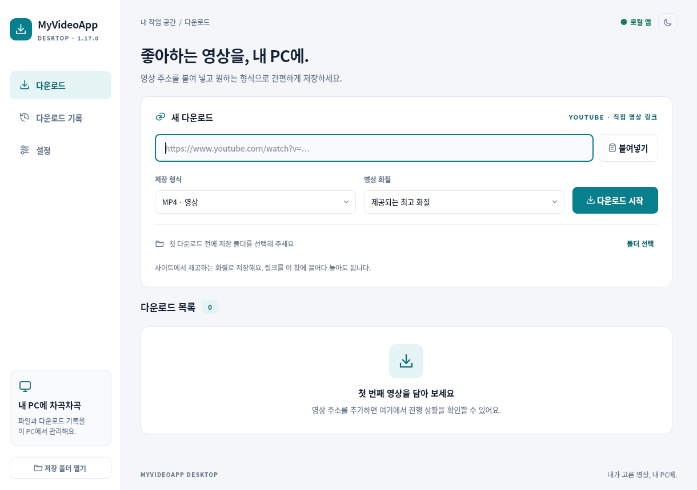
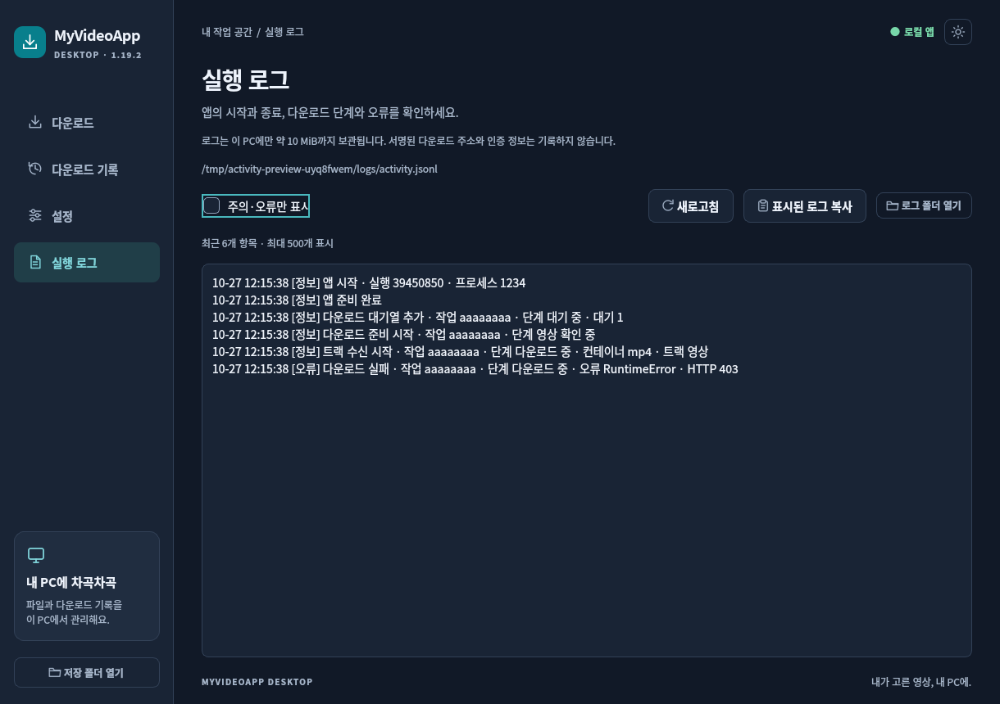

# My Video App

**Chrome 확장 프로그램과 Windows 데스크톱 앱으로 제공되는 미디어 다운로드 도구입니다.**

**YouTube 공개 단일 영상·Shorts는 Windows 앱**으로 다운로드하고, **Chrome 확장은 일반 웹페이지의 미디어 및 비암호화 HLS/DASH 다운로드**에 사용합니다. 두 프로그램의 지원 기능은 서로 다릅니다.

- **최신 버전:** [v1.19.4 릴리스](https://github.com/P-JSL/myapps/releases/tag/v1.19.4) · [항상 최신 릴리스 보기](https://github.com/P-JSL/myapps/releases/latest)
- **Windows 앱:** Windows 10/11 x64, 압축 해제 후 바로 실행. Python, yt-dlp, FFmpeg 등 필요 구성요소 포함
- **Chrome 확장:** 개발자 모드에서 압축 해제된 폴더를 로드
- **서비스 계정·구독·API 키:** 프로그램 사용에 필요하지 않음

## 먼저 어떤 프로그램을 사용해야 하나요?

| 필요한 기능 | Chrome 확장 | Windows 앱 |
| --- | --- | --- |
| **YouTube 공개 영상·Shorts 다운로드** | **미지원** | **지원** |
| 일반 미디어 및 비암호화 HLS/DASH | 감지·다운로드 및 로컬 처리 | 지원하는 직접 미디어 주소 다운로드 |
| MP3/M4A 및 화질 선택 | 지원하는 원본 트랙 및 변환 범위 | 제공 화질·형식 선택, FFmpeg 병합 |
| 여러 파일 대기열·취소·재시도 | 브라우저 기능 및 확장 인터페이스 | 최대 16개 동시 작업과 사이트별 제한 |
| 다운로드 기록·로그 | 브라우저 로컬 기록 | SQLite 기록 + 실행 로그 화면 |
| 선택적 백신 연동 | 별도 로컬 도우미 | Windows 보안 검사 설정 |

**지원하지 않는 것:** DRM 해제, 로그인·유료 이용 권한 우회, 라이브 녹화. 사이트가 접근을 제한하거나 미디어 제공 방식을 변경하면 다운로드가 실패할 수 있습니다.

## 다운로드

**[Downloads 폴더에서 설치 파일 받기](Downloads/)** · [최신 Release 전체 보기](https://github.com/P-JSL/myapps/releases/latest)

| 파일 | 사용자에게 필요한 내용 |
| --- | --- |
| **[Windows 앱 ZIP 다운로드](https://github.com/P-JSL/myapps/releases/latest/download/my-video-app-desktop-windows-x64.zip)** | **my-video-app-desktop-windows-x64.zip**을 전부 풀고 **My Video App.exe** 실행. Windows 10/11 x64, Python·yt-dlp·Deno·FFmpeg·Qt 포함 |
| **[Chrome 확장 ZIP](artifacts/my-video-app-extension.zip)** | 영상 감지·일반 미디어·HLS/DASH 다운로드·로컬 미디어 도구. **YouTube 미지원** |
| [전체 소스 ZIP](artifacts/my-video-app-source.zip) | 확장·앱·빌드 스크립트·의존성 잠금·검사 코드 |
| [확장 백신 도우미](artifacts/my-video-app-antivirus-helper.zip) | Chrome 확장의 선택적 로컬 백신 연동. 데스크톱 앱의 YouTube에는 필요하지 않음 |

**Windows 앱 ZIP은 GitHub 일반 Git 파일 제한(100MiB)을 넘으므로 Release에 보관합니다.** 저장소의 [Downloads 폴더](Downloads/)에는 실제 ZIP을 내려받는 링크를 제공합니다. [배포 워크플로](.github/workflows/release.yml)가 버전·코드·고정 의존성으로 앱을 빌드하고 확장 ZIP과 함께 게시합니다. 비공개 저장소의 Release는 권한 있는 계정으로 로그인해야 접근할 수 있습니다.



## 설치 전에 확인할 점

- **Windows 앱**은 ZIP을 반드시 **새 폴더에 전체 압축 해제**하세요. 기존 버전 폴더에 덮어쓰면 제거된 런타임 파일이 남아 오류를 일으킬 수 있습니다.
- **Chrome 확장**은 `manifest.json`이 있는 폴더를 지정해야 합니다.
- `Code → Download ZIP`은 소스 코드입니다. Windows 실행 파일은 **GitHub Release**에서 받으세요.
- 파일이 정상 다운로드되었는지 확인하려면 릴리스의 `SHA256SUMS-RELEASE.txt`와 체크섬을 비교할 수 있습니다.

## Windows 앱 사용

1. Release에서 Windows 앱 ZIP을 내려받아 폴더 전체를 압축 해제합니다.
2. **My Video App.exe** 실행 → 최초 다운로드 전에 **저장 폴더 선택**.
3. 영상 주소 붙여 넣기 → 화질·형식 선택 → **다운로드 추가**.
4. 대기열에서 진행률·속도·남은 시간을 확인하고, 완료 후 **폴더 열기**를 누릅니다.

**다운로드마다 저장 창을 띄우지 않습니다.** 저장 폴더는 설정에서 바꿉니다. 최고 화질·해상도 선택, 영상·음성 병합, MP3/M4A 저장, 취소·재시도, 검색 가능한 기록, 밝은/어두운 테마를 제공합니다. 상세 실행법은 [Windows 앱 안내](desktop/README.ko.md)를 참고하세요.

**설정 → 동시 다운로드**에서 자동(PC의 논리 CPU 수에 따라 2~4개) 또는 1~16개를 선택하세요. **같은 사이트 동시 다운로드**는 기본 4개이며 1~16개로 바꿀 수 있습니다. 예를 들어 YouTube 영상 8개를 동시에 진행하려면 두 설정을 모두 8개 이상으로 지정합니다. 기존에 저장한 1개·2개 설정은 유지합니다. 수를 낮춰도 진행 중인 다운로드는 취소하지 않고 완료 후 새 제한을 적용합니다.

조각 다운로드의 전체 예산과 영상 분석·변환·백신 검사 수를 별도로 제한합니다. 작업 수를 늘려도 서버·회선·디스크의 한계를 넘는 속도 향상을 보장하지는 않습니다. [설계와 논문·프로그램 조사](reports/DESKTOP_CONCURRENCY_RESEARCH.ko.md)를 참고하세요.

영상·음성을 받는 중간에 별도 네이티브 전송기로 전환하지 않습니다. 직접 파일은 기존 yt-dlp 다운로드 방식, HLS/DASH 조각은 1.18의 제한된 조각 병렬 처리를 사용합니다. 한 작업에서 클라이언트를 재사용하며 작업 간 상태를 공유하지 않습니다. 인터넷·YouTube 속도 향상을 수치로 보장하지는 않습니다.

## Chrome 확장 설치

1. 확장 ZIP을 풀고 `chrome://extensions`에서 개발자 모드를 켭니다.
2. **압축 해제된 확장 프로그램 로드** → `manifest.json`이 있는 `my-video-app` 폴더 선택.
3. **설정 → 다운로드 저장 폴더**에서 Chrome의 저장 폴더 절대경로를 선택하고 **다운로드 전에 각 파일의 저장 위치 확인을 OFF**로 바꾼 뒤 최초 설정을 완료합니다.
4. 영상 페이지를 새로고침하고 재생 → 확장 아이콘 → 다운로드.

기존 설치는 같은 폴더에 새 ZIP 내용을 갱신하고 확장을 새로고침하세요. **YouTube 주소·재생 조각은 확장에서 다운로드하지 않으며 Windows 앱으로 안내합니다.** 백신 연동은 ON/OFF할 수 있고, Windows Defender 기본 연동 및 다른 백신 연결은 기존 [안내](native/README.ko.md)를 따릅니다.

## 실행 로그와 데이터 위치

**Windows 앱 사이드 메뉴 → 실행 로그**에서 실행·종료, 다운로드·병합·검사 과정, 취소·재시도·오류를 확인합니다. **주의·오류만 표시**, **표시된 로그 복사**, **로그 폴더 열기**를 사용할 수 있습니다.

| 구분 | 저장 위치 및 처리 |
| --- | --- |
| 다운로드한 영상·음성 | 사용자가 설정한 다운로드 폴더 |
| 설정·기록 | `%LOCALAPPDATA%\MyVideoApp\Desktop`의 사용자 데이터(SQLite 포함) |
| 실행 로그 | `%LOCALAPPDATA%\MyVideoApp\Desktop\logs\activity.jsonl` |
| 로그 용량 | 파일당 약 2MiB, 현재 파일과 과거 파일 최대 4개를 순환 보관 |

실행 로그에 영상 주소·쿠키·인증 헤더 등의 민감한 원문을 저장하지 않도록 구현되어 있지만, **외부 공유 전에 내용을 확인**하세요. 다운로드 기록을 지워도 실제 저장된 영상 파일이 자동 삭제되는 것은 아닙니다.



## 문제 해결

| 증상 | 조치 |
| --- | --- |
| Windows 앱이 실행되지 않음 | Windows 10/11 x64 여부 확인, ZIP을 새 폴더에 다시 전체 압축 해제 |
| 다운로드 결과 파일이 보이지 않음 | **설정 → 다운로드 폴더**와 완료 작업의 **폴더 열기** 확인 |
| YouTube가 확장에서 감지되지 않음 | **Windows 데스크톱 앱** 사용. Chrome 확장은 YouTube 미지원 |
| 영상·음성 다운로드가 실패함 | 원본 주소·접근 권한·네트워크·디스크 공간 확인 후 **다운로드 기록 → 다시 시도** |
| 오디오 단계에서 실패함 | 실행 로그에서 HTTP 상태와 오류 단계 확인 후 해당 작업 재시도 |
| 여러 개 다운로드가 느림 | **설정 → 동시 다운로드**에서 전체 및 같은 사이트 제한을 줄여 비교 |
| Chrome 확장이 로드되지 않음 | 확장 ZIP 압축 해제, `manifest.json` 위치, `chrome://extensions` 개발자 모드 확인 |
| 로컬 백신 도우미 연결 실패 | [백신 도우미 사용 안내](native/README.ko.md)에서 확장 ID 및 설치 절차 확인 |

**보안 검사 신호가 없더라도 악성코드가 전혀 없다고 보장하지 않습니다.** 업데이트 후 문제가 발생하면 이전 설치 파일을 덮어쓰지 말고 새 폴더에서 실행해 보세요.

## 빌드·검사

Node.js 24 이상과 Python 3.11 이상이 필요합니다. 의존성은 고정 URL·해시로 검증하며 개발·빌드 캐시는 패키지에 포함하지 않습니다.

```sh
npm ci
npm run typecheck
npm run build
python3 -B scripts/archive.py
python3 desktop/launcher/build.py --fetch-toolchain
python3 -B scripts/build-desktop.py
```

데스크톱 실행 파일은 Windows x64용입니다. **1.19.4에서는 1.18 복원 경로·로그 유지·GUI·배포 범위만 검사하고 이전 검사는 건너뜁니다.** 실제 yt-dlp와 FFmpeg로 로컬 영상·음성을 다운로드·병합해 원본 스트림을 비교합니다. 빌드의 의존성 해시 확인과 압축 파일 생성은 그대로 수행합니다. [이번 변경과 검사 범위](reports/DESKTOP_1_19_4.ko.md)

[1.19 변경과 검사 범위](reports/DESKTOP_1_19.ko.md) · [1.18 변경과 검사 범위](reports/DESKTOP_1_18.ko.md) · [저작권·제3자 고지](THIRD_PARTY_NOTICES.md) · [데스크톱 고지](desktop/THIRD_PARTY_NOTICES.md)

## 버전 및 기술 문서

현재 README는 사용자용 기능·설치·문제 해결을 우선합니다. 이전 버전의 상세 구현 내용과 검증 기록은 아래 문서에 남겨 두었습니다.

- [전체 릴리스 및 이전 버전](https://github.com/P-JSL/myapps/releases)
- [Windows 앱 상세 사용법](desktop/README.ko.md)
- [다운로드 파일 안내](Downloads/README.md)
- [v1.19.4 다운로드 경로 복원 및 검증](reports/DESKTOP_1_19_4.ko.md)
- [동시 다운로드 설계 및 성능 검토](reports/DESKTOP_CONCURRENCY_RESEARCH.ko.md)
- [Chrome 확장 백신 연결 안내](native/README.ko.md)
- [제3자 저작권 및 라이선스](THIRD_PARTY_NOTICES.md) · [데스크톱 고지](desktop/THIRD_PARTY_NOTICES.md)

콘텐츠의 저작권과 원본 사이트의 이용 조건은 사용자가 확인해야 합니다. 이 프로그램은 접근 권한이 없는 콘텐츠를 가져오는 기능을 제공하지 않습니다.
