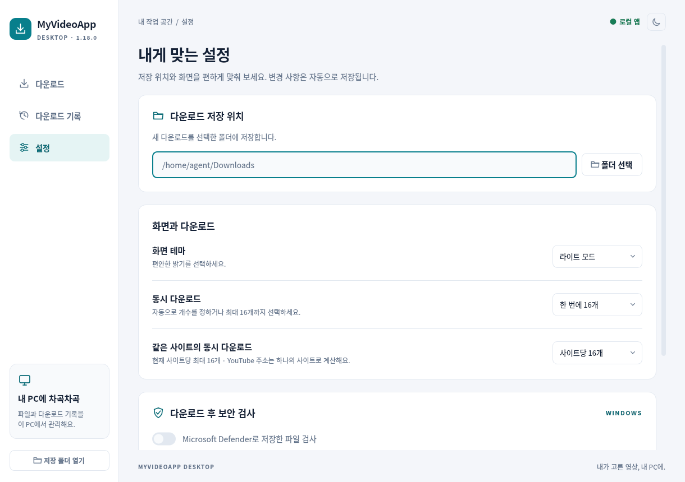

# My Video App 1.18.0 · 데스크톱 동시 다운로드

작성일: 2026-10-26 (KST). 기준 배포: `v1.17.0`, 커밋 `252b452da32f16dc81cb36cca94231879d43c5f1`.

**Windows 앱의 동시 다운로드 상한을 2개에서 16개로 늘렸습니다.** 설정에서 전체 작업 수와 같은 사이트 작업 수를 각각 선택합니다. 기존 1개·2개 설정은 유지하며 새 설치는 자동 2~4개, 사이트당 4개가 기본입니다. YouTube 8개를 함께 진행하려면 두 설정을 모두 8개 이상으로 지정하세요.

## 구현

| 부분 | 변경 |
| --- | --- |
| 정책 공통화 | `desktop/concurrency.py`에서 자동·수동 범위, 사이트 키, 단계별 예산을 관리. 잘못된 저장값은 기본값으로 읽고 새 저장값은 엄격히 확인 |
| 작업 수 | Qt 작업 풀·GUI 전체 상한·엔진 전체 작업 예산을 16개로 일치. 여러 Engine 인스턴스도 같은 프로세스 예산 공유 |
| 사이트별 배정 | 현재 실행 수가 적은 사이트 우선, 같은 조건에서는 먼저 추가한 작업 우선. 앞 사이트가 상한에 걸려도 다른 사이트 작업 시작 |
| 전송 예산 | 전체 조각 병렬도 예약 합계 16. 한 트랙에 실제 전체 상한 `C`에 대해 `max(1, min(4, 16 // C))`개를 한 번에 예약. 일반 직접 HTTP 파일은 1개 예약 |
| 단계 분리 | 메타데이터 분석 최대 2개, 미디어 처리 최대 2개, 백신 검사 최대 1개. 전송이 끝나면 전송 예산을 반환하고 다음 단계로 진행 |
| CPU 경합 | FFmpeg의 입력·출력 코덱 및 필터 스레드 옵션을 2로 설정. 프로세스 전체의 OS 스레드 수가 2개라는 의미는 아님 |
| 취소·실행 중 설정 | FIFO 자원 대기는 취소 시 예약 없이 빠짐. 값을 높이면 추가 작업 시작, 낮추면 진행 중 작업을 완료하면서 새 상한 적용 |
| UI 부하 | 같은 단계 진행률 알림을 약 100ms 간격으로 줄임. 단계 변경·첫 100%·완료 결과는 즉시 전달 |

사이트 상한은 입력 주소의 호스트를 기준으로 하며 YouTube 별칭을 하나로 묶습니다. 실제 리디렉션·CDN의 모든 TCP 연결을 세는 제한은 아닙니다. 조각 예산도 추출기 요청·DNS·연결 풀을 포함한 전역 소켓 수 측정치가 아닙니다. 이미 실행 중인 작업은 선점하지 않습니다.

저자 제공 원문으로 확인한 SEDA(SOSP 2001)와 Adaptive Overload Control(USITS 2003), yt-dlp·aria2·qBittorrent·Netflix의 실제 구현을 검토했습니다. 이 앱에 적용한 원칙과 제외한 기법, 인용 절 및 URL은 [조사 보고서](DESKTOP_CONCURRENCY_RESEARCH.ko.md)에 기록했습니다. 상한 16·2·1이 논문으로 증명된 최적값이거나 속도가 8배 빨라진다는 뜻은 아닙니다.

## 이번 신규 검사

**요청에 따라 이전에 수행한 테스트·검사는 다시 실행하지 않았습니다.** 새 변경을 위한 아래 세 파일만 실행했습니다. Linux에서 실제 Windows 실행 파일을 실행한 것은 아니며 Windows 배포에서는 내장 Python·Qt로 동일한 신규 검사만 실행합니다.

| 신규 파일 | 개수 | 확인한 내용 |
| --- | ---: | --- |
| `desktop/test_concurrency.py` | 14 | 두 Engine 합계 16개 다운로드 생명주기와 SQLite, 17번째 대기, 단계별 상한, 가중치 예약, 취소 후 반환, 설정 범위·이전 값·모듈 공유 |
| `desktop/test_concurrency_gui.py` | 9 | 실제 Qt 작업자 8개와 엔진·SQLite, 사이트 제한·앞 작업에 의한 막힘 회피·배정 순서, 실행 중 증감, 취소, 10,000개 진행률 입력과 최종 결과 전달 |
| `tests/test_concurrency_release.py` | 15 | 신규 검사 범위·버전·기준 커밋·현재 커밋·플랫폼·ZIP 해시 확인, 기존 태그 유지, 신규 검사만 호출하는 배포 절차 |
| **합계** | **38** | **Linux 통과. 실행 로그: `reports/validation-1.18/`** |

동시성 검사는 실제 Engine·작업자·큐·파일 게시·SQLite를 사용하고 외부 의존성·추출기·다운로더·자식 프로세스 경계를 대체합니다. 실제 YouTube·외부 사이트의 다운로드 성공률·전송량·속도에 대한 검증은 아닙니다. 릴리스 검사에서 출력하는 테스트용 `Published ... aaaa...`는 외부 전송 없는 모의 호출입니다.

새 설정 화면은 1220×860과 최소 1000×700에서 확인했습니다. 최소 높이에서는 세로 스크롤로 두 설정을 확인하며 가로 잘림은 없습니다. [화면 검토 기록](desktop-concurrency-visual-review.json)을 참고하세요.

건너뛴 항목: 기존 엔진·GUI·실제 MP4/MP3/M4A·런처·백신·브라우저·HTTP/3·알고리즘·전체 단위 검사, 기존 의존성 감사와 TypeScript 타입 검사. 빌드에 필요한 고정 의존성 해시 확인, 버전 일치와 새 ZIP 무결성 확인은 패키징 절차로 유지합니다.

## 빌드와 배포

Chrome 확장은 동작 변경 없이 버전 메타데이터만 1.18.0으로 갱신했습니다. Windows 런타임 의존성 버전은 그대로이며 앱 코드·정책·문서와 런처 버전 리소스를 새로 묶습니다. 상세 ZIP 정보는 `desktop-build.json`, 신규 검사·로그·소스 식별 정보는 `release-validation.json`을 기준으로 합니다.

GitHub Actions는 새 세 검사만 통과하면 실제 Windows 패키지 해시와 검사 범위를 `WINDOWS-VALIDATION.json`에 기록하고 Release에 첨부합니다. 게시 단계는 이 증거가 현재 버전·커밋·패키지와 일치하는지 확인합니다. 이전 검사를 통과했다고 다시 기록하지 않습니다. 기존 `v1.17.0` 태그는 이동하지 않습니다.

**앱 ZIP은 [Downloads 폴더](../Downloads/README.md) 또는 [1.18.0 Release](https://github.com/P-JSL/myapps/releases/tag/v1.18.0)에서 받습니다.** ZIP 전체를 풀고 `My Video App.exe`를 실행하세요. 100MiB를 넘으므로 Git 파일로 중복 저장하지 않습니다.
