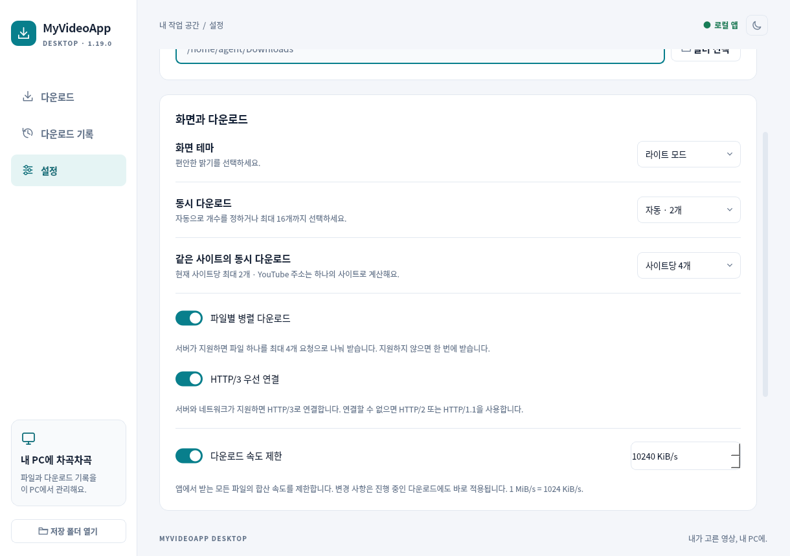

# My Video App 1.19.0 · 전송 가속·HTTP/3·속도 제한

작성일: 2026-10-27 (KST). 기준 버전: `v1.18.0`, 커밋 `1756c8dec1cb6e655fd486ab4a55fcc35641fd74`.

**공개 직접 미디어의 분할 전송과 HTTP/3 우선 연결, 앱 전체 속도 제한 ON/OFF를 추가했습니다.** 기존 동시 작업 수·사이트별 상한은 유지합니다. 새 전송·통합·제한기·배포 범위만 검사하며 이전 테스트는 반복하지 않습니다.

## 사용자가 바꿀 설정

| 설정 | 기본값 | 적용 범위 |
| --- | --- | --- |
| 파일별 병렬 다운로드 | ON | 8MiB 이상이고 서버의 범위·강한 ETag가 검증되는 직접 파일을 최대 4개 요청으로 전송 |
| HTTP/3 우선 연결 | ON | 새 직접 전송 경로에서 시도. 서버·UDP·프록시 조건이 맞지 않으면 HTTP/2·HTTP/1.1 폴백 |
| 다운로드 속도 제한 | **OFF** | 켜면 여러 파일·분할 요청·기존 yt-dlp의 미디어 바이트 합계에 상한 적용 |
| 속도 상한 | 10,240KiB/s 저장 | ON일 때 사용. 64~1,048,576KiB/s, 1MiB/s=1,024KiB/s |

설정은 자동 저장되며 속도 제한의 증감·ON/OFF는 진행 중인 작업에도 반영됩니다. OFF는 앱의 대역폭 상한을 해제합니다. 서버·회선의 제한을 제거한다는 의미는 아닙니다. 최대 64KiB 초기 버스트를 허용하며 TLS·헤더·OS 버퍼까지 포함한 물리 회선 속도계는 아닙니다.

## 전송 경로와 안전 조건

- 새 `transport.py`는 고정된 curl_cffi/libcurl로 HTTPS 인증서와 호스트를 검증합니다. 실제 협상 결과만 HTTP/3·HTTP/2·HTTP/1.1로 표시하며, HTTPS 주소나 Alt-Svc 광고를 성공으로 간주하지 않습니다.
- 상속된 프록시를 유지합니다. CONNECT 프록시가 지정되면 원본이 QUIC을 지원하더라도 프록시를 우회하지 않으며 HTTP/2 폴백을 사용합니다. 브라우저 지문 위장·쿠키 추출·로그인/DRM 우회는 추가하지 않습니다.
- 전송 큐는 응답당 최대 두 개의 64KiB 슬롯으로 제한합니다. 큐가 비었을 때 고정 50ms를 쉬는 대신 데이터 도착 즉시 깨어나도록 바꿨습니다. 핸들의 연결 캐시는 요청 사이에 재사용합니다.
- `transfer.py`는 파일의 접두 범위·전체 크기·강한 ETag를 확인한 뒤 4MiB 구간을 요청합니다. 조각마다 `If-Match`·`If-Range`, 206 상태, 정확한 Content-Range·크기·ETag를 확인합니다. 원본이 바뀌거나 응답이 불완전하면 중단하고 이번 작업이 생성한 파일만 정리합니다.
- 검증 조건이 맞지 않으면 쓰기 전에 단일 전송으로 바꿉니다. 큰 파일 전체를 RAM에 올리지 않고 정확한 오프셋에 기록합니다. 전체 네트워크 예산 16은 읽기·검증·기록이 끝날 때까지 유지하며 재시도 대기에는 반환합니다.
- 일시 오류와 짧은 Retry-After는 제한 횟수·지연으로 재시도합니다. 대기 중에도 취소할 수 있습니다. HLS/DASH와 기존 YouTube 이어받기는 기존 yt-dlp 경로를 유지합니다.
- `bandwidth.py`의 공유 토큰 버킷은 최대 64KiB씩 FIFO 순서로 미디어 바이트를 허용합니다. 여러 작업이 한 합계 상한을 공유하고 설정 변경 시 대기자를 깨웁니다. 기존 yt-dlp의 누적 진행률은 중복·역순 값과 이미 받은 이어받기 바이트를 다시 청구하지 않습니다.

라이브러리 배포 파일·공식 API·RFC·확장과의 차이·선택 이유는 [조사 보고서](DESKTOP_TRANSPORT_RESEARCH.ko.md)에 기록했습니다. Windows DLL은 공식 curl-impersonate 2.3.1 릴리스와 바이트 전체 일치를 확인했으며 해당 라이선스 고지를 함께 포함합니다.

## 실제 전송 시험

루프백 서버가 **연결당 4MiB/s**로 응답하도록 설정하고 같은 데이터의 SHA-256과 실제 겹쳐 실행된 요청 수를 확인했습니다. 최신 수치는 [desktop-transfer.json](desktop-transfer.json)을 기준으로 합니다.

| 조건 | 단일 요청 방식 | 파일별 4개 분할 | 해석 |
| --- | ---: | ---: | --- |
| 16MiB 파일 한 개 | 약 4.11초 | 약 1.11초 | 이 로컬 조건에서 약 3.7배 |
| 16MiB 파일 네 개 동시 | 합계 약 15.57MiB/s | 합계 약 52.90MiB/s | 이 로컬 조건에서 약 3.40배, 전송 예산 최대 16 |

모든 결과의 파일 해시가 일치했습니다. 이 시험은 연결당 제한이 있는 로컬 서버이며 **인터넷·YouTube 처리량의 개선 배수로 일반화할 수 없습니다.** 실제 YouTube 서버 다운로드와 공인망 성능은 측정하지 않았습니다.

별도 TLS/QUIC 서버에서 HTTP/1.1·HTTP/2·HTTP/3의 실제 페이로드와 프로토콜을 확인했습니다. 알려지지 않은 CA의 거부, HTTP/3 불가 시 HTTP/2 폴백, HTTPS 다운그레이드 차단, 응답 대기·읽기 취소, 프록시 경유와 합성 프록시 인증의 원본 누출 방지를 신규 검사에 포함했습니다. 실제 관측 프로토콜은 [desktop-transport.json](desktop-transport.json)에 남깁니다.

## 신규 검사와 배포 범위

새 `test_transfer.py`, `test_transport.py`, `test_transport_engine.py`, `test_bandwidth.py`, `test_transport_release.py`만 실행합니다. 실제 원본·TLS·QUIC·프록시 서버를 사용하는 검사와 외부 의존성을 대체한 엔진·Qt 통합 검사를 구분합니다. Linux에서 총 **89개 신규 검사**가 통과했습니다(transfer 10 / transport 15 / engineTransport 28 / bandwidth 9 / releaseScope 27). 로그와 정확한 검사 수는 `reports/validation-1.19/` 및 `release-validation.json`에 기록합니다.

이전 1.18 동시성 검사, 기존 전체 엔진·GUI·브라우저·HTTP/3 하네스·백신·런처·MP4/MP3/M4A·알고리즘·의존성 감사·타입 검사는 다시 실행하지 않았습니다. 빌드의 고정 입력 해시·버전·새 압축 파일 무결성 확인은 유지합니다.

Windows Release 작업은 내장 Python·Qt·curl_cffi로 같은 신규 범위만 실행합니다. QUIC 서버용 도구는 해시가 고정된 테스트 의존성으로 별도 설치하며 제품에 포함하지 않습니다. 실제 HTTP/3 관측 보고서와 현재 패키지 해시·커밋·검사 범위가 모두 일치해야 게시합니다. 원시 프로토콜 보고서와 `WINDOWS-VALIDATION.json`을 Release에 함께 첨부합니다. 기존 버전 태그는 이동하지 않습니다.

설치 ZIP은 [Downloads](../Downloads/README.md) 또는 [1.19.0 Release](https://github.com/P-JSL/myapps/releases/tag/v1.19.0)에서 받습니다. ZIP 전체를 풀고 `My Video App.exe`를 실행하세요.
