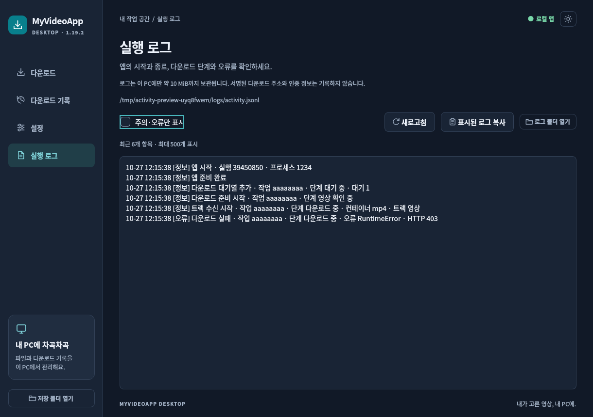

# 1.19.2 실행 로그와 GUI 조회

앱의 실행부터 종료까지와 다운로드 처리 중의 오류를 확인할 수 있도록 로컬 실행 로그를 추가했습니다. 다운로드 전송 방식·복구 정책·동시성·속도 제한·백신 설정은 유지합니다.

## 사용 방법

1. Windows ZIP 전체를 갱신한 뒤 **My Video App.exe**를 실행합니다.
2. 사이드 메뉴의 **실행 로그**를 누릅니다.
3. 필요한 경우 **주의·오류만 표시**를 켜고 새로고침합니다. 화면은 한국어 단계·오류 요약을 제공하고, 복사 버튼은 표시 중인 항목들의 상세 JSONL 기록을 제공합니다. 로그 폴더도 열 수 있습니다.

파일 위치는 `%LOCALAPPDATA%\MyVideoApp\Desktop\logs\activity.jsonl`입니다. 현재 파일과 이전 파일 4개를 파일당 약 2MiB로 순환 보관합니다. GUI는 최근 기록을 제한된 수만큼 보여 주며 파일 전체를 무제한으로 불러오지 않습니다.

## 기록 범위

| 구간 | 남기는 정보 |
| --- | --- |
| 앱 | 시작·준비 완료·종료, 초기화 오류, 처리하지 못한 Python 예외 |
| 대기열 | 작업 추가·시작·취소 요청·재시도, 작업 ID |
| 다운로드 | 준비·메타데이터 분석·트랙 시작/완료/재사용, 일정 간격의 진행률·바이트 수 |
| 복구 | 일반 전송/호환 전송 전환, 실패한 트랙과 단계 |
| 후처리 | 원본 파일 검사·병합/변환·최종 저장·백신 검사·완료·취소·실패 |
| 오류 | 예외 종류, 안전한 단계 코드, HTTP 상태 또는 숫자 OS 오류 코드, 코드의 파일명·함수·행 |

각 실행은 실행 ID, 각 다운로드는 작업 ID로 연결합니다. 매 바이트나 매 화면 갱신마다 파일을 쓰지 않고 진행 기록을 줄입니다. 로그 기록 실패가 다운로드 실패로 바뀌지 않도록 분리했습니다.

## 개인정보와 보관 한계

원본 주소·서명된 미디어 URL·쿠키·인증 헤더·API 키·영상 제목·사용자 폴더 경로와 원시 추출기/외부 프로그램 오류는 기록하지 않습니다. 허용된 이벤트·형식·숫자 메타데이터만 구조화해 저장하고, 예외의 로컬 변수나 인수도 수집하지 않습니다. 파일을 외부로 자동 전송하지 않습니다.

파일 쓰기가 실패하면 GUI에 저장 불가 상태를 표시하고 실행 중 제한된 메모리 기록으로 조회를 이어갑니다. 메모리 기록은 종료 후 유지되지 않을 수 있습니다. 순환 보관 범위를 넘은 오래된 기록은 교체되며, 강제 종료·전원 차단 직전의 마지막 기록 저장을 보장하지 않습니다.

## 이번 검사 범위

**사용자 요청에 따라 이전에 수행한 검사는 모두 건너뛰었습니다.** 새 실행 로그 24개, 로그 GUI 14개, 1.19.2 배포 범위 10개, 총 48개가 통과했습니다. 기존 다운로드 복구·HTTP/3·속도 제한·전체 GUI·브라우저·백신 검사와 실제 YouTube 서버 다운로드를 재검증했다는 의미는 아닙니다.

새 검사는 스키마·민감정보 제외·동시 기록·회전 보관·손상된 줄·파일 쓰기 실패·다운로드 결과 보존·진행 기록 빈도, 로그 화면·오류 필터·복사·예외 후크·종료 시 작업 정리와 인스턴스 잠금 수명을 확인했습니다. 파일 읽기는 보관 범위로 제한하고 최근 항목이 채워지면 중단합니다. 오류 필터는 정상 진행 줄의 JSON 파싱을 생략합니다. Linux에서 개발용 Qt와 통제된 오프라인 입력으로 검사했으며, Windows 내장 런타임에서도 같은 새 검사만 실행하도록 했습니다.

고정 의존성 입력의 해시 확인, 실행 파일 버전 갱신, ZIP 생성과 파일 목록/현재 소스 일치 확인은 빌드·패키징 과정에서 유지합니다. Windows에서 새 검사들이 통과해야 Release가 게시됩니다. 현재 빌드와 로그의 해시는 `release-validation.json`, 실제 Windows 결과는 Release의 `WINDOWS-VALIDATION.json`에 연결합니다.
